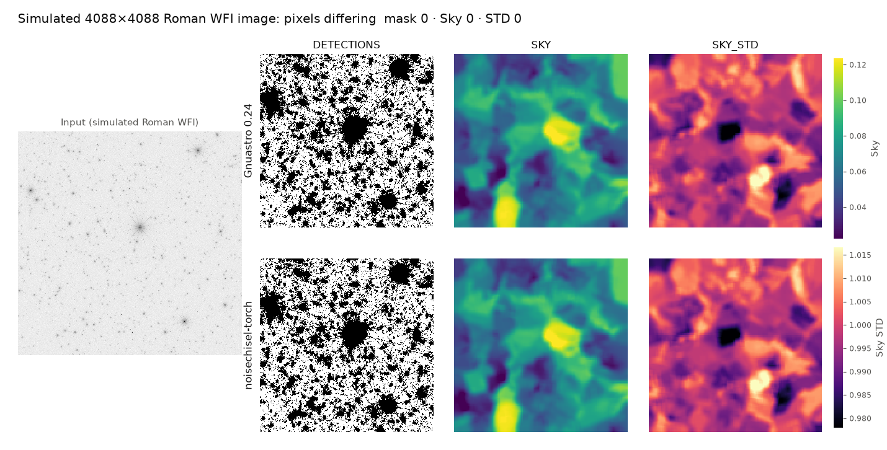
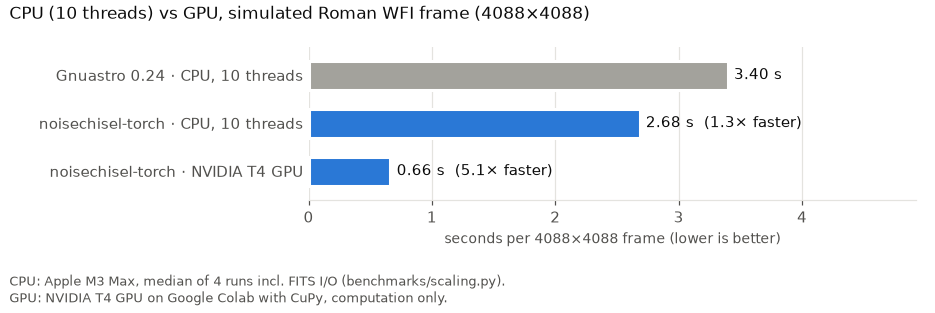
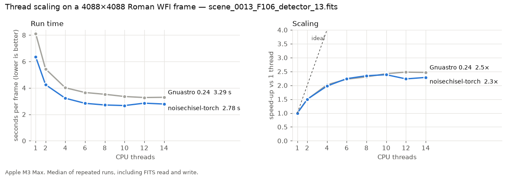

# noisechisel-torch

[](https://github.com/PabloMSanAla/noisechisel/actions/workflows/tests.yml)
[](https://pypi.org/project/noisechisel-torch/)
[](https://colab.research.google.com/github/PabloMSanAla/noisechisel/blob/main/notebooks/colab_gpu_benchmark.ipynb)

A PyTorch port of [Gnuastro](https://www.gnu.org/software/gnuastro/)'s
**NoiseChisel**, which detects faint signal in noise and measures the Sky and
Sky STD. It runs on CPU or CUDA, and its detection mask, Sky and Sky STD are
**bit-identical** to `astnoisechisel` 0.24 with default options.





### Scaling with CPU threads



Both programs gain little beyond about 6–10 threads (at most 2.4–2.5× over
one thread), and noisechisel-torch is faster at every thread count. The CPU
times in the bar chart above are taken from this test at 10 threads.

All benchmarks use simulated Roman WFI frames (4088×4088). CPU: Apple M3 Max,
median of 4 runs including FITS read and write. GPU: Colab T4 with CuPy.
Data: `benchmarks/results/scaling_m3max.csv`, made with `benchmarks/scaling.py`.

## Install

```bash
pip install "noisechisel-torch[fits]"            # CPU, with astropy for FITS I/O and the CLI
pip install "noisechisel-torch[fits,cuda12]"     # + CuPy for GPU labelling (cuda13 for CUDA 13 drivers)
```

Install only one CuPy package, matched to your driver's CUDA version.

## Usage

```python
from astropy.io import fits
from noisechisel_torch import noisechisel, NoiseChisel

img = fits.getdata("image.fits", ext=0)
res = noisechisel(img, device="cuda")   # or device="cpu", numthreads=8
res.detections                          # bool mask (H, W)
res.sky_image(), res.std_image()        # per-pixel Sky and Sky STD

nc = NoiseChisel(device="cuda", tilesize=(64, 64), qthresh=0.3)   # reuse on many images
res = nc(img)
```

```bash
noisechisel-torch image.fits -h 0 -o image_detected.fits --device cuda
noisechisel-torch image.fits -h 0 -o image_detected.fits --device cpu -N 8   # 8 CPU threads
```

Options keep Gnuastro's names and defaults (`tilesize`, `qthresh`, `erode`,
`snquant`, ...; see `NoiseChiselParams`). The output file has the same HDUs as
`astnoisechisel`. Add `--oneelempertile` to write Sky/STD with one value per
tile, which cuts a 4088² output from ~200 MB to ~85 MB.

## Validation

* Identical masks, Sky and STD on 18 simulated Roman WFI detectors, on the frame shown
  above and on images with NaN regions.
* `benchmarks/compare_gnuastro.py` runs both programs on your images and
  reports pixel differences and timings. `benchmarks/readme_figures.py` makes
  the output comparison figure and `benchmarks/scaling.py` the timing figures.
* CI runs the tests on Linux, macOS and Windows (Python 3.11/3.12) and
  compares against Gnuastro 0.24 on Linux and macOS.

## Development

```bash
mamba create -n noisechisel-dev -c conda-forge python=3.12 gnuastro=0.24 pytorch numpy scipy astropy pytest pip
mamba activate noisechisel-dev
pip install -e ".[test]"
pytest
```

To release, bump `version` in `pyproject.toml`, merge to `main`, then tag that
commit and push the tag:

```bash
git tag v0.1.0 && git push origin v0.1.0
```

The `publish` workflow checks the tag is on `main` and matches the version,
runs the tests, and uploads to PyPI.

## Limitations

* 2D single-channel images only. NaN pixels are never detected, and check
  images are not written.
* Apple MPS has no float64, so `device="mps"` runs on the CPU.
* Without CuPy, labelling on CUDA goes through host memory (scipy), which is
  slower.

## License

GPL-3.0-or-later. This is a derivative of Gnuastro, © Free Software Foundation.
